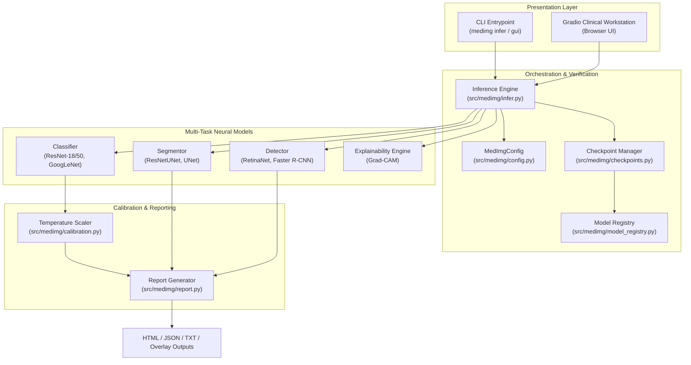
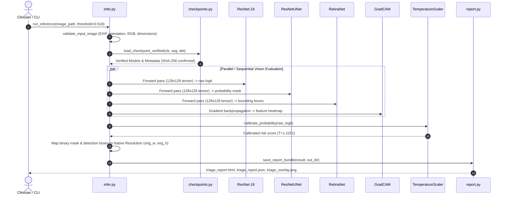

# System Architecture & Technical Design

This document details the software architecture, design patterns, tensor dataflows, checkpoint management system, and runtime execution pipelines of the **Medical Imaging Triage & Lesion Analysis Workstation (`medimg`)**.

---

## 1. High-Level System Architecture

The workstation is designed as a modular, Software-as-a-Medical-Device (SaMD) research prototype. It decouples core mathematical foundations, deep learning vision models, post-hoc uncertainty calibration, interpretability mechanisms, and user presentation interfaces.



---

## 2. Component Layout & Modular Subsystems

| Module | Primary Responsibility | Key Interfaces |
|---|---|---|
| `src/medimg/config.py` | Centralized, immutable project configuration and environment variable overrides | `MedImgConfig`, `CONFIG` |
| `src/medimg/checkpoints.py` | Cryptographically validated checkpoint persistence and retrieval | `save_checkpoint`, `load_checkpoint_verified`, `clone_state_dict` |
| `src/medimg/model_registry.py` | Architectural specifications, constructor factories, and input requirements | `MODEL_REGISTRY`, `get_model_spec` |
| `src/medimg/calibration.py` | Post-hoc empirical Temperature Scaling ($T$) and calibration metrics | `TemperatureScaler`, `compute_calibration_metrics` |
| `src/medimg/infer.py` | End-to-end multi-task inference pipeline and coordinate transformations | `run_inference`, `validate_input_image` |
| `src/medimg/gradcam.py` | Native-resolution gradient-weighted class activation mapping | `GradCAM`, `generate` |
| `src/medimg/report.py` | Standalone, zero-hallucination clinical report bundles (JSON, HTML, TXT) | `save_report_bundle`, `generate_html_report` |
| `src/medimg/app_gradio.py` | Interactive, state-aware browser workstation | `create_demo`, `predict_fn` |
| `src/medimg/fundamentals/` | Mathematical verification from first principles (Pure NumPy) | `conv2d`, `jacobi_svd`, `MLP`, `Adam` |

---

## 3. End-to-End Inference Dataflow

The unified inference pipeline (`run_inference` in `src/medimg/infer.py`) processes input images through seven deterministic stages:



### Stage Details

1. **Input Ingestion & Sanitation:**
   - Ingests file path or in-memory PIL image.
   - Applies `ImageOps.exif_transpose` to prevent orientation discrepancies.
   - Enforces RGB conversion (discarding RGBA alpha channels gracefully).
   - Validates dimension bounds ($16 \times 16 \le \text{size} \le 25\text{ MP}$).
2. **Preprocessing:**
   - Bilinear downsampling to model canonical spatial resolution ($128 \times 128$).
   - Channel normalization using ImageNet statistics ($\mu = [0.485, 0.456, 0.406]$, $\sigma = [0.229, 0.224, 0.225]$).
3. **Multi-Task Neural Execution:**
   - Evaluated under `torch.inference_mode()` (with temporary `torch.enable_grad()` for Grad-CAM).
   - Execution on GPU (`cuda`) if present, with transparent fallback to `cpu`.
4. **Post-Hoc Probability Calibration:**
   - Temperature Scaling applied: $p_{\text{cal}} = \sigma(\text{logit} / T)$.
   - Operating threshold comparison: $\text{Priority} = \text{HIGH}$ if $p_{\text{cal}} \ge \theta_{\text{val}}$ (where $\theta_{\text{val}} = 0.518$ guarantees Sensitivity $\ge 95\%$).
5. **Coordinate & Mask Inversion:**
   - The predicted binary segmentation mask ($128 \times 128$) is resampled back to native image dimensions $(W_{\text{orig}}, H_{\text{orig}})$ using nearest-neighbor interpolation to prevent boundary blur.
   - Bounding box coordinates $[x_1, y_1, x_2, y_2]$ from RetinaNet are scaled by $(W_{\text{orig}} / 128, H_{\text{orig}} / 128)$.
6. **Interpretability Heatmap Generation:**
   - Grad-CAM targets the final convolutional stage (`layer4[-1]` of ResNet-18).
   - Heatmap normalized $\in [0, 1]$, colored with a colormap, and alpha-blended over the original lesion image.
7. **Clinical Report Bundling:**
   - Generates machine-readable JSON (EHR ingestion), standalone self-contained HTML (clinician browser inspection), and human-readable plain text summary.

---

## 4. Checkpoint Management & Verification Architecture

To guarantee reproducibility and eliminate silent fallback bugs (`DEF-04`, `DEF-05`, `DEF-06`), `src/medimg/checkpoints.py` enforces strict loading rules:

### Checkpoint File Specification

Each model artifact consists of a paired binary weight file and sidecar JSON metadata:
- Binary weights: `runs/checkpoints/<model_name>.pt`
- Provenance metadata: `runs/checkpoints/<model_name>.json`

```json
{
  "model_name": "resnet18",
  "task": "classification",
  "num_parameters": 11186645,
  "sha256": "4b7a...",
  "created_at": "2026-11-21T08:15:00Z",
  "operating_threshold": 0.518,
  "target_sensitivity": 0.95,
  "calibration": {
    "method": "temperature_scaling",
    "temperature": 1.2251
  },
  "dataset_split": {
    "method": "lesion_grouped_stratified",
    "group_col": "lesion_id"
  }
}
```

### CPU-Isolated State Dict Cloning

In PyTorch, naive checkpoint snapshotting on CPU via `{k: v.cpu() for k, v in model.state_dict().items()}` produces tensors that share underlying storage buffers with the active training model. Subsequent training iterations in-place mutate the saved "best" checkpoint!

To eliminate this vulnerability, `clone_state_dict` enforces:
```python
def clone_state_dict(model: torch.nn.Module) -> Dict[str, torch.Tensor]:
    """Create a completely decoupled, CPU-isolated copy of model state."""
    return {
        k: v.detach().cpu().clone()
        for k, v in model.state_dict().items()
    }
```

---

## 5. Security, Privacy, and Regulatory Controls

1. **Decompression Bomb Protection:** Pillow's `MAX_IMAGE_PIXELS` is bounded at $25,000,000$ pixels ($25\text{ MP}$), preventing Denial-of-Service via maliciously crafted image headers.
2. **In-Memory Lifecycle & Zero Disk Leaks:** All image processing in the Gradio UI executes directly on in-memory buffers or isolated, automatically collected `tempfile.TemporaryDirectory` instances.
3. **No Network Telemetry:** Inference runs entirely offline without dynamic model downloading or external API calls.
4. **Software-as-a-Medical-Device (SaMD) Framing:** All reports, UI headers, and CLI outputs present clear investigational use disclaimers in compliance with FDA Tier II clinical decision-support guidance.
